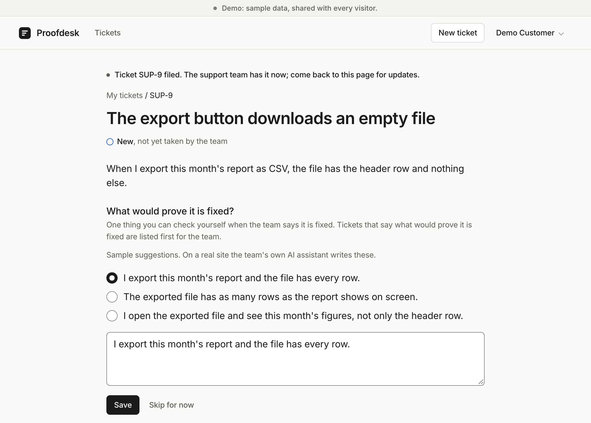

# Proofdesk

AI assistants do their best work when a prompt gives the problem, the context and a way to check
the result, and people do too. A Proofdesk ticket has that shape: a title for the problem, a
description for the context, and what would prove it is fixed. So whoever picks it up, a person
or an assistant, can tell when it is done.

Say what would prove it is fixed, and your ticket is listed first and checked against your own words.

- **The demo, no account needed: <https://support-desk-demo.fly.dev>.** Sample data, shared with
  everyone who visits, so do not type anything private. It returns to its samples by itself when
  it has been quiet for a while.
- **The production site: <https://proofdesk.fly.dev>.** People sign in with GitHub and start as customers.
- **The source: <https://github.com/yylerbrown/proofdesk>.**


## Run it yourself

You need Node 22.14 or newer (`node -v`; `.nvmrc` says 22). Clone the repository with
`git clone https://github.com/yylerbrown/proofdesk.git` and `cd proofdesk`, then:

```bash
npm ci
```

```bash
DEV_SIGN_IN=on npm run dev
```

Open <http://localhost:3000> and pick one of four made-up people: two customers, a team member
and an admin. No keys are needed. Demo mode, a production build, Docker, GitHub sign-in and every
setting are in [More ways to run](docs/DEPLOY.md#more-ways-to-run).

## One ticket, start to finish

On the demo, in about two minutes, with eight presses:

1. The demo opens on your ticket list as the Demo Customer. On the welcome card above the list,
   press **File a sample ticket**, then **File ticket**. The form holds a sample you can change.
2. The filed ticket asks "What would prove it is fixed?", with three sample suggestions as "+"
   buttons, the first already added to the box. Press **Save**: the ticket is **New**, with your words under that label.



3. Press **View this ticket as a team member**, then **Take ticket and start work**. The ticket
   is **In Progress**, and you own it.
4. Press **Mark fixed and tell the customer**, agreeing the proof above it was met: it is **Resolved**.
5. Press **View this ticket as the customer who filed it**, then **Yes, it is fixed** under "Did
   this fix it?": the ticket reads "Resolved, customer confirmed", with a solid green check in
   the list's Proof column.


The customer's Yes is optional, and their "No, it is not fixed" sends the ticket back to the
team with their words. The team's Status menu, under the title, moves a ticket between New and
In Progress in one press. Its Resolved opens a short form with five reasons, and the ticket then
shows `Resolved by the team: <reason>` to everyone.

[`docs/TOUR.md`](docs/TOUR.md) goes feature by feature: the proof step, filters and search,
pictures, possible duplicates, changing many tickets at once, email notices and the rest.

## Tests

```bash
npm test    # npm run test:coverage also shows coverage
```

Over 2,000 unit and route tests with vitest, against a real SQLite file and the real app. Then
`npm run test:browser` (after `npx playwright install chromium webkit`), `npm run typecheck`,
`npm run lint` and `npm run format:check` finish the checks every merge passes.

## Sign-in and roles

The production site signs people in with GitHub; Microsoft sign-in for one organization is
built and off until its three settings are set. Proofdesk reads your name and email address, and
your picture from GitHub, never your files, mail or code, and keeps no GitHub token. An admin
chooses who is on the team on the **People** page, and the change applies on that person's next
page. People named in the server settings keep that role and show as locked on **People**. The
menu under each person's name links their account page, with a switch for email notices.

| Role        | How someone gets it                                       | What they do                                                                                                                                                                                                                                                                                                                                                            |
| ----------- | --------------------------------------------------------- | ----------------------------------------------------------------------------------------------------------------------------------------------------------------------------------------------------------------------------------------------------------------------------------------------------------------------------------------------------------------------- |
| Customer    | Everyone, at first sign-in.                               | Files tickets and says what would prove each one fixed. Reads, edits, replies on and archives their own, answers "Did this fix it?", and reopens a resolved ticket that is still broken. Never sees internal notes.                                                                                                                                                     |
| Team member | An admin chooses it on **People**, or `TEAM_GITHUB_IDS`.  | Sees every ticket, takes one and starts work, replies, writes internal notes, marks a ticket fixed (agreeing its proof was met) and tells the customer, archives and restores. Hands on a ticket they own, resolves with a reason a ticket they own or a New ticket nobody owns, and can reopen it if the team resolved it. Changes many tickets at once from the list. |
| Admin       | An admin chooses it on **People**, or `ADMIN_GITHUB_IDS`. | Everything a team member does. Hands on or resolves any open ticket, can reopen any ticket the team resolved, chooses who is on the team, issues AI assistant connections on **Connections**, and deletes a ticket permanently.                                                                                                                                         |

On the demo there is no sign-in: you start as Demo Customer, and the menu at the top right
switches to Demo Team Member or Demo Admin (read-only), who sees everything and changes nothing.
**About this demo**, in every page's footer, says how the demo works.

## The AI assistant

Proofdesk makes no AI calls of its own. A person's own assistant works on tickets through an MCP
endpoint, with only the permissions its connection allows. **See an assistant's work**
(<https://support-desk-demo.fly.dev/assistant-run>) shows one recorded run. The assistant worked
in a scratch file from the ticket's text, because it had no access to the product's code. There
it reproduced the arithmetic problem and tested a fix, then proposed a test, attached the run as
evidence and asked the owner to review it. It resolved nothing: a test can pass while the
customer is still stuck, so only the customer's Yes counts as confirmed.

[Three real faults](docs/dogfood-run/summary.md) were filed as tickets in a local Proofdesk. A
listening assistant offered ways to prove each fix within about five seconds, and a headless
assistant fixed each with a test. A second AI agent, as the team member and the customer, re-ran the
tests before pressing "Mark fixed and tell the customer". No human was in the loop. The first fixer
run, blocked by the operator's own permission settings, was run once more with the same prompt.

To try it, open **About this demo** from the demo's footer, then **Connect your own AI
assistant** and **Get a demo connection**, for a key that lasts a day at most and a message to
paste into your assistant. On the production site an admin issues connections, and a ticket's
owner hands the ticket to one; an admin can also let it suggest ways to prove a new ticket fixed.
[`docs/AGENTS_GUIDE.md`](docs/AGENTS_GUIDE.md) has the setup, the tools and the limits. An
assistant can read everything it needs in one fetch: <https://support-desk-demo.fly.dev/llms.txt>.

## Read first

1. [`src/server/permissions.ts`](src/server/permissions.ts): the capability table and `can()`,
   who may take each action.
2. [`src/server/tickets/workflow.ts`](src/server/tickets/workflow.ts): taking a ticket and
   changing its status. Then [`resolve-and-reopen.ts`](src/server/tickets/resolve-and-reopen.ts):
   `resolveWithReason`, which marking fixed calls, and
   [`customer-question.ts`](src/server/tickets/customer-question.ts): `confirmFix`, the customer's Yes.
3. [`tests/confirmation.test.ts`](tests/confirmation.test.ts): confirmation, on the real routes.
4. [`tests/capabilities.test.ts`](tests/capabilities.test.ts): every action, tested for agents.

Express 5 and TypeScript (strict), SQLite with numbered migrations, EJS pages, Better Auth for
GitHub sign-in and zod for every input. Routes read the request, the ticket service
([`service.ts`](src/server/tickets/service.ts) assembles one file per concern) holds the rules,
and repositories hold the SQL; the pages, the [JSON API](docs/API.md) and MCP call the same
service. The top-level `ops/prove` folder is a command-line check, apart from the site, for a
patch an assistant proposes ([`ops/prove/README.md`](ops/prove/README.md)).
[`docs/ARCHITECTURE.md`](docs/ARCHITECTURE.md) maps the rest.

## How the work was directed

An AI coding assistant wrote the implementation. The owner defined the behaviour, broke the work
into small changes and directed the checking, including outside reviews of the design and the
code. The specification ([`docs/SPEC.md`](docs/SPEC.md)), the history of every step
([`docs/BUILD_LOG.md`](docs/BUILD_LOG.md)) and the checks are in the repository.

## Known limits

- **The version check is up to API callers.** The pages always send the version they show, so a
  save or a press from an old copy is refused. A JSON or MCP caller that leaves out
  `expected_version` is not checked, and archive and restore take no version.
- **Email needs a mail server.** Notices are written to an outbox from the ticket history and
  sent with nodemailer only once `SMTP_URL` and `MAIL_FROM` are set; each person can switch them
  off on their account page. The demo never sends, so there a ticket's notices page shows each
  one as not sent, with its exact words.
- **Evidence is reported, not verified.** Proofdesk shows who reported it and checks none of it.
- **One machine.** SQLite on one disk; rate-limit counts are in memory and reset on a restart.
- **Roles in the server settings win** over the People page until the settings change.
- **Demo visitors share identities.** Everyone who views as Demo Customer is the same customer,
  so a visitor's picture on the demo is shown only to the browser that added it.
- **The dev login's cookie is unsigned**, safe only because production refuses the dev login.
- **`ops/prove` is not a sandbox.** It runs the candidate code on the machine with only the
  environment cleaned.
- **No bulk handover when someone leaves the team.** The People page will not make someone a
  customer while they own open tickets, and names those tickets, so each is handed on first. A
  reopened ticket whose owner has left goes back to New with no owner.
- **Left out on purpose:** a board with status columns, priority ordering and any model call of
  the site's own.
- **Design debt**, each item with its plan: [`ARCHITECTURE.md`](docs/ARCHITECTURE.md#design-debt).

## More

- [`docs/TOUR.md`](docs/TOUR.md): every feature, and where to find it on the demo.
- [`docs/API.md`](docs/API.md): every JSON route, errors, retries, and trying it with `curl`.
- [`docs/AGENTS_GUIDE.md`](docs/AGENTS_GUIDE.md): connecting an AI assistant over MCP.
- [`docs/SECURITY.md`](docs/SECURITY.md): the security measures, their tests, and deletion.
- [`docs/DEPLOY.md`](docs/DEPLOY.md): other ways to run, every setting, Docker and Fly.io.
- [`docs/ROADMAP.md`](docs/ROADMAP.md): what comes next.
- [`docs/SPEC.md`](docs/SPEC.md): what was decided, and when it changed.
- [`docs/BUILD_LOG.md`](docs/BUILD_LOG.md): how each step was asked for, and what was found.
