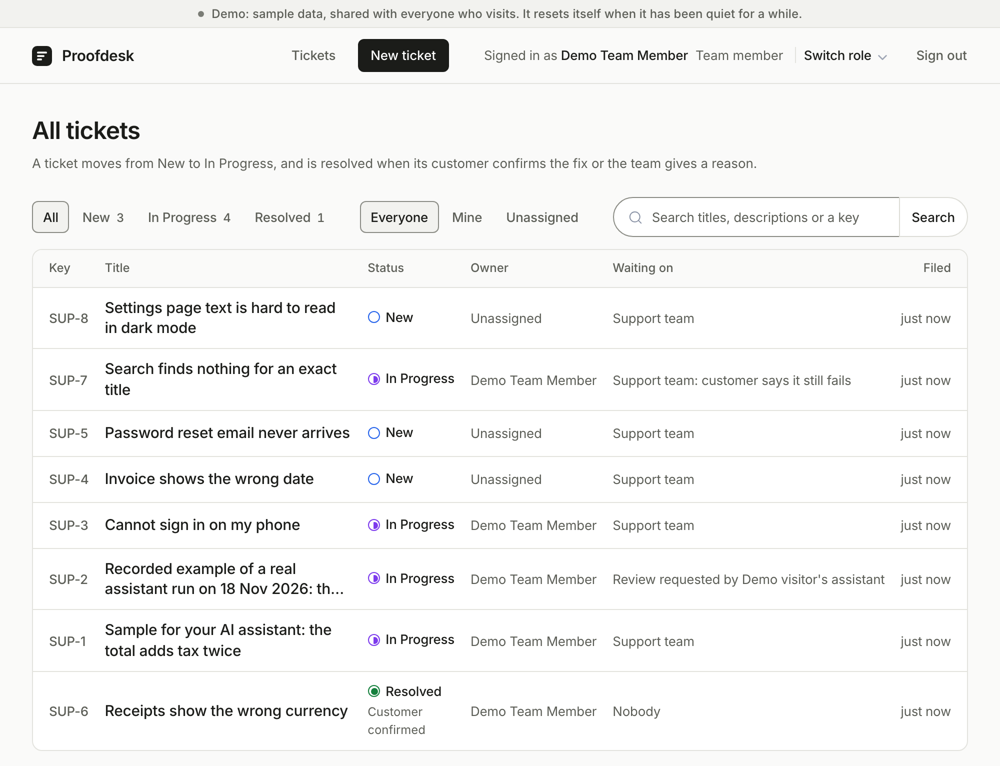
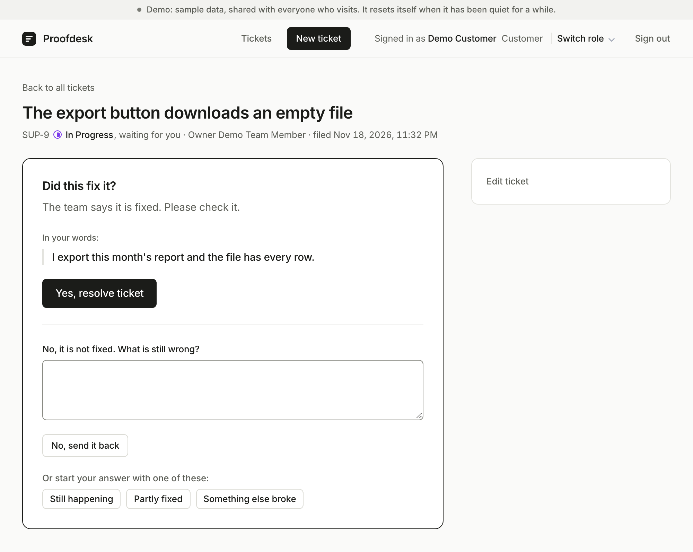

# Proofdesk

A customer support ticketing system. Customers file tickets with a title and a description, the
team works them through New, In Progress and Resolved, and everyone can filter and search the
list. The twist: the customer writes how they will know it is fixed, and the ticket asks them
"Did this fix it?" before it counts as confirmed.

- **The demo, no account needed: <https://support-desk-demo.fly.dev>.** Sample data, shared with
  everyone who visits, so do not type anything private. It returns to its samples by itself when
  it has been quiet for a while.
- **The production site, with GitHub sign-in: <https://proofdesk.fly.dev>.**
- **The source: <https://github.com/yylerbrown/proofdesk>.**



## Run it yourself

You need Node 22.14 or newer (`node -v`; `.nvmrc` says 22). Clone the repository with
`git clone https://github.com/yylerbrown/proofdesk.git` and `cd proofdesk`, then:

```bash
npm ci
```

```bash
DEV_SIGN_IN=on npm run dev
```

Open <http://localhost:3000> and pick one of four made-up people. No keys are needed. Demo mode,
a production build, Docker, GitHub sign-in and every setting are in
[More ways to run](docs/DEPLOY.md#more-ways-to-run).

## One ticket, start to finish

On the demo, in about two minutes:

1. The demo opens on your ticket list as the Demo Customer. On the welcome card above the list,
   press **File a sample ticket**, then **File ticket**. The form is filled with a sample you can
   change, and the filed ticket shows **New**.
2. Press **View this ticket as a team member**, then **Take ticket and start work**. The ticket
   is **In Progress**, and you own it.
3. Press **Ask the customer to verify**, then **View this ticket as the customer who filed it**.
4. The customer meets their own check, in their words. Press **Yes, resolve ticket**: the ticket
   is **Resolved**, and says "Customer confirmed it is fixed."



The team also has a plain Status row: New, In Progress, and "Resolve with a reason…". Moving to
New or In Progress is one press. To resolve without the customer, press "Resolve with a reason…"
under Status and choose a reason; the ticket then shows `Resolved by the team: <reason>` to
everyone.

[`docs/TOUR.md`](docs/TOUR.md) goes feature by feature: filters and search, two people on one
ticket, email notices and the rest.

## Tests

```bash
npm test
```

Over 1,000 unit and route tests with vitest, against a real SQLite file and the real app.
`npm run test:browser` runs the Playwright journey (run `npx playwright install chromium webkit`
once first), and `npm run typecheck`, `npm run lint` and `npm run format:check` run the rest of
the checks every merge passes.

## Sign-in and roles

The production site signs people in with GitHub. Proofdesk reads your name, picture and email
address, never your code, and keeps no GitHub token after sign-in. An admin chooses who is on the
team on the **People** page, and the change applies on that person's next page. People named in
the server settings keep that role and show as locked on **People**. Each person's name in the
header opens their account page, with a switch for email notices.

| Role        | How someone gets it                                       | What they do                                                                                                                                                                                                                                                                                      |
| ----------- | --------------------------------------------------------- | ------------------------------------------------------------------------------------------------------------------------------------------------------------------------------------------------------------------------------------------------------------------------------------------------- |
| Customer    | Everyone, at first sign-in.                               | Files tickets. Reads, edits, replies on and archives their own, answers "Did this fix it?", and reopens a resolved ticket that is still broken. Never sees internal notes.                                                                                                                        |
| Team member | An admin chooses it on **People**, or `TEAM_GITHUB_IDS`.  | Sees every ticket, takes one and starts work, replies, writes internal notes, attaches evidence, asks the customer to verify, archives and restores. Hands on a ticket they own, resolves with a reason a ticket they own or a New ticket nobody owns, and can reopen it if the team resolved it. |
| Admin       | An admin chooses it on **People**, or `ADMIN_GITHUB_IDS`. | Everything a team member does. Hands on or resolves any open ticket, can reopen any ticket the team resolved, chooses who is on the team, issues AI assistant connections on **Connections**, and deletes a ticket permanently.                                                                   |

On the demo there is no sign-in: you start as Demo Customer, and **Switch role** in the header
changes to Demo Team Member or Admin preview (read-only) on the same ticket. The admin preview
sees everything and changes nothing, and nobody archives or deletes there. **About this demo**,
in every page's footer, says how the demo works.

## The AI assistant

Proofdesk makes no AI calls of its own. A person's own assistant works on tickets through an MCP
endpoint, with only the permissions its connection allows. **See an assistant's work**
(<https://support-desk-demo.fly.dev/assistant-run>) shows one recorded run. The assistant worked
in a scratch file from the ticket's text, because it had no access to the product's code. There
it reproduced the arithmetic problem and tested a fix, then proposed a test, attached the run as
evidence and asked the owner to review it. It resolved nothing, because only the customer's Yes
confirms a fix: a test can pass while the customer is still stuck.

To try it, open **About this demo** from the demo's footer, then **Connect your own AI
assistant** and **Get a demo connection**, for a key that lasts a day at most and the command to
paste. On the production site an admin issues connections, and a
ticket's owner hands the ticket to one. [`docs/AGENTS_GUIDE.md`](docs/AGENTS_GUIDE.md) has the
setup, the tools and the limits. An assistant can read everything it needs in one fetch:
<https://support-desk-demo.fly.dev/llms.txt>.

## Read first

For someone reading the code, in this order:

1. [`src/server/permissions.ts`](src/server/permissions.ts): the capability table and `can()`,
   who may take each action.
2. [`src/server/tickets/workflow.ts`](src/server/tickets/workflow.ts): taking a ticket and
   changing its status. Then
   [`customer-question.ts`](src/server/tickets/customer-question.ts): `markReady` (the owner asks
   "Did this fix it?") and `answer` (the customer's Yes or No), and
   [`resolve-and-reopen.ts`](src/server/tickets/resolve-and-reopen.ts): `resolveWithReason`.
3. [`tests/confirmation.test.ts`](tests/confirmation.test.ts): the confirmation workflow on the
   real routes.
4. [`tests/capabilities.test.ts`](tests/capabilities.test.ts): every action, tested for agents
   from the capability table.

Express 5 and TypeScript (strict), SQLite with numbered migrations, EJS pages, Better Auth for
GitHub sign-in and zod for every input. Routes read the request, the ticket service
([`service.ts`](src/server/tickets/service.ts) assembles one file per concern) holds the rules,
and repositories hold the SQL; the pages, the [JSON API](docs/API.md) and MCP call the same
service. The top-level `ops/prove` folder is a command-line check, apart from the site, for a
patch an assistant proposes ([`ops/prove/README.md`](ops/prove/README.md)).
[`docs/ARCHITECTURE.md`](docs/ARCHITECTURE.md) maps the rest.

## How the work was directed

An AI coding assistant wrote the implementation. The owner defined the behaviour, broke the work
into small changes and directed the checking, including outside reviews of the design and the
code. The specification ([`docs/SPEC.md`](docs/SPEC.md)), the history of every step
([`docs/BUILD_LOG.md`](docs/BUILD_LOG.md)) and the checks are in the repository.

## Known limits

- **The version check is up to API callers.** The pages always send the version they show, so a
  save or a press from an old copy is refused. A JSON or MCP caller that leaves out
  `expected_version` is not checked, and archive and restore take no version.
- **Email needs a mail server.** Notices are written to an outbox from the ticket history and
  sent with nodemailer only once `SMTP_URL` and `MAIL_FROM` are set; each person can switch them
  off on their account page. The demo never sends, so there a ticket's notices page shows each
  one as not sent, with its exact words.
- **Evidence is reported, not verified.** Proofdesk shows who reported it and checks none of it.
- **One machine.** SQLite on one disk; rate-limit counts are in memory and reset on a restart.
- **Roles in the server settings win** over the People page until the settings change.
- **Demo visitors share identities.** Everyone who views as Demo Customer is the same customer.
- **The dev login's cookie is unsigned.** It is safe only because production refuses the dev
  login.
- **`ops/prove` is not a sandbox.** It runs the candidate code on the machine with only the
  environment cleaned.
- **No bulk handover when someone leaves the team.** The People page will not make someone a
  customer while they own open tickets, and names those tickets, so each is handed on first. A
  reopened ticket whose owner has left goes back to New with no owner.
- **Left out on purpose:** a board with status columns, priority ordering and any model call of
  the site's own.
- **Design debt** is listed with a plan for each item in
  [`docs/ARCHITECTURE.md`](docs/ARCHITECTURE.md#design-debt).

## More

- [`docs/TOUR.md`](docs/TOUR.md): every feature, and where to find it on the demo.
- [`docs/API.md`](docs/API.md): every JSON route, errors, retries, and trying it with `curl`.
- [`docs/AGENTS_GUIDE.md`](docs/AGENTS_GUIDE.md): connecting an AI assistant over MCP.
- [`docs/SECURITY.md`](docs/SECURITY.md): the security measures and their tests, and permanent
  deletion.
- [`docs/DEPLOY.md`](docs/DEPLOY.md): other ways to run, every setting, Docker and the Fly.io
  hosting.
- [`docs/ROADMAP.md`](docs/ROADMAP.md): what comes next.
- [`docs/SPEC.md`](docs/SPEC.md): what was decided, and when it changed.
- [`docs/BUILD_LOG.md`](docs/BUILD_LOG.md): how each step was asked for, what came back and what
  was found.
